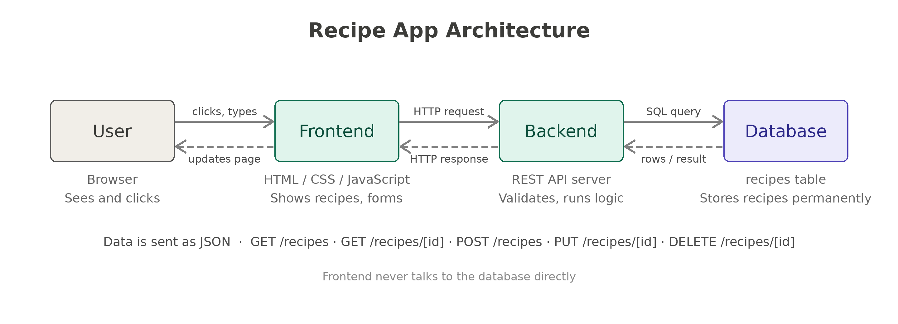
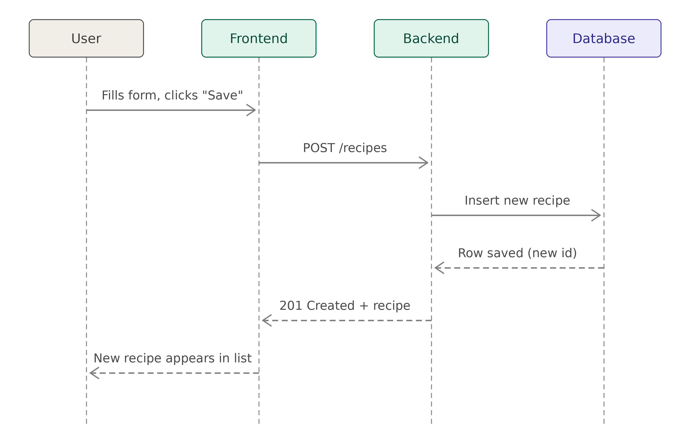
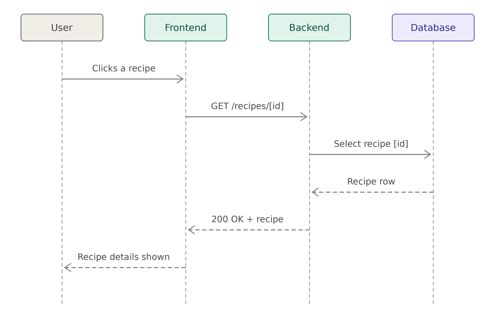
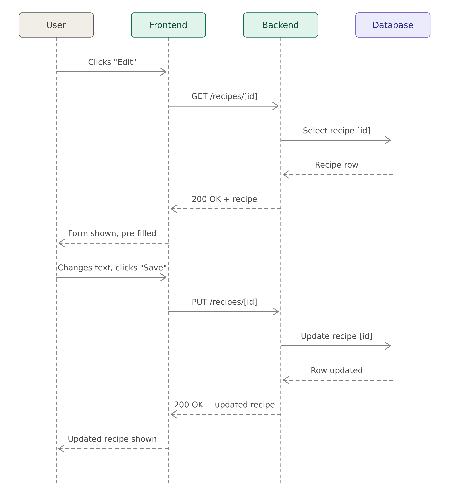

# Recipe Collection App

An app where you can save your favorite recipes, look at them, change them and delete them.

---

## 1. Architecture



The app has 3 parts: a frontend, a backend and a database. The user only uses the frontend. The frontend talks to the backend, and only the backend talks to the database.

---

## 2. The components

### Frontend

This is the part the user sees in the browser: the list of recipes, the page for one recipe and the form to add or edit. It does not save anything itself. When the user clicks something, it sends a request to the backend and shows whatever comes back.

### Backend

This is the server. It gets the requests from the frontend, checks the data talks to the database and sends an answer back.

The requests the frontend can send:

```
GET     /recipes           get all recipes
GET     /recipes/[id]      get a recipe by its id
POST    /recipes           add a new recipe
PUT     /recipes/[id]      change a recipe by its id
DELETE  /recipes/[id]      delete a recipe by its id
```

### Database

This is where the recipes are saved for good, so they are still there when the browser is closed. Each recipe has:

```
id            (a number: automatically)
title
ingredients
instructions
```

### Linking frontend and backend?

With HTTP requests and responses. The data in form of JSON. The frontend never touches the database directly.

---

## 3. Sequence diagrams

### Adding a recipe



```
User fills in the form and clicks "Save"
Frontend sends POST /recipes with the recipe data
Backend checks the data and saves it to the database
Database saves it and returns the new id
Backend sends 201 Created
Frontend shows the new recipe in the list
```

---

### Viewing one recipe



```
User clicks a recipe in the list
Frontend sends GET /recipes/[id]
Backend asks the database for the recipe with that id
Database returns the recipe
Backend sends 200 OK with the recipe
Frontend shows title, ingredients and instructions
```

---

### Editing a recipe



```
User clicks "Edit"
Frontend sends GET /recipes/[id] to fill the form with the current recipe
User changes the text and clicks "Save"
Frontend sends PUT /recipes/[id] with the new data
Backend checks the data and updates the recipe with that id in the database
Database confirms the update
Backend sends 200 OK with the updated recipe
Frontend shows the updated recipe
```
